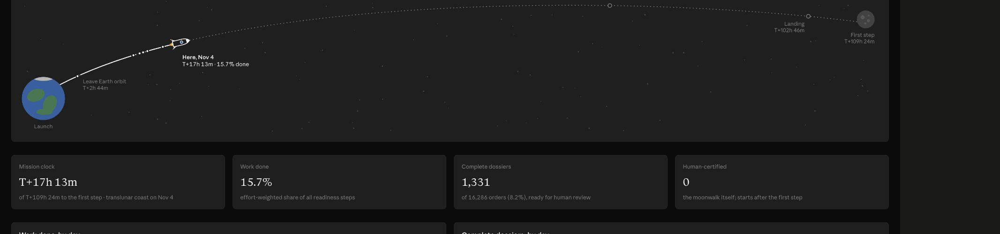

# Tribonian readiness publication — November 4, 2026

**Published readiness is 1,331 of 14,972 working identities, up from 784 (+547).** The live control center and original Mission rocket both show the verified generation. Human-certified whole histories remain 0.

## Exact accounting

| Measure | Verified count |
|---|---:|
| Reported main-wave filings | 545 |
| Final o27 pair, omitted from saved disposition | 2 |
| Distinct published Tribonian orders | 547 |
| Native exact file/line/ID/canonical-hash matches | 547 / 547 |
| Already ready before Tribonian | 0 |
| Newly ready Tribonian orders | 547 |
| Filed Tribonian orders still blocked | 0 |
| Baseline-ready orders retained | 784 |
| Previously ready orders lost | 0 |
| Unrelated gains / losses | 0 / 0 |

The 53 correction filings concerned previously rejected, unfiled versions; the actual zero-overlap join establishes the gain without assuming they replaced ready dossiers. The o27 pair is EO13128 and EO13274. Published claims and current exact checker receipts establish the pair; retained o27 completion/review folders were not located and are not represented as recovered originals.

Ready text tiers are 804 original-supported and 527 transcription-dependent. Across the tracker, 1,886 original-replacement obligations and 1,886 quotation rechecks remain. These are separate from readiness and from human certification.

## Separate recovery cohort

These 48 mechanically refused, unfiled orders are outside the 547 reconciliation.

| Exact cause | Orders | Next action |
|---|---:|---|
| Custody only | 32 | Retain exact source bytes, create a fresh packet and check review applicability |
| Custody plus short quotation | 1 | Repair both custody and the quoted span through normal review |
| Short quotation only | 11 | Supply an adequate exact source span; review any changed claim |
| Quotation not found | 1 | Resolve source/version/span mismatch |
| Quoted instrument absent from universe | 3 | Resolve exact instrument identity/registration without inferring admission |

The full IDs are retained in [RECOVERY.json](../../progress/tribonian-finalization-20261104/RECOVERY.json). DISPOSITION's 579 not-filed attempt rows represent 549 distinct IDs and include retry overlap; they are not an additive backlog count. Its broad custody characterization is replaced here by the exact 33 custody-involved refusal audit.

Project-wide, 13,641 identities remain unready. Principal overlapping reasons include 10,681 without provisional status, 2,846 missing a clause inventory, 2,846 without closed savings/residuals, 2,455 without proved first ending and 391 without current operating basis. Source blockers overlap these legal gaps. Use the [current tracker summary](../../../jobs/readiness-tracker/output/SUMMARY.json) for all categories rather than adding them.

## Publication and model

- [Control center](https://executive-orders-production-atlas.d3mosth3n3s.chatgpt.site/#overview): visible 1,331, 804/527 text tiers, 0 human-certified, November 4, 15:52 Eastern tracker receipt. Existing same-main-commit refresh accepted the data; no Site audience or source deployment changed.
- [Original Mission rocket](https://claude.ai/artifact/531KGTebdrgdeUitKhp8du#apollo): refreshed existing mission_log CSV, tested 12 rows, saved and verified visible 1,331, 15.73% modeled work, T+17h13m, November 4.
- The maintained Capcom builder preserved all 10 historical checkpoints and added November 2 / November 4. Frozen weights, milestones and 1,314-order census gap are unchanged. The modeled goal remains 16,286; this is distinct from 14,972 working identities and the retained APP label 16,239.
- The legacy artifact's static November 2 main-check annotation remains historical. Current Mission and dynamic headline use the refreshed dataset. Its pace extrapolation is an existing unvalidated visualization, not a completion forecast.

## Source pins and checks

Readiness PR[#142](https://github.com/D3m0sthene5/Executive-Orders/pull/142) merged as 5289ac5aad4b9e96ef156095081f5572669c5d84. Native tracker output originally committed as 446bdc5d; main merge is the November 4 first-parent Mission checkpoint.

Native finalization output is committed as 51914da4b58fb425b710e070ef10c20da6f119a4. [RECONCILIATION.json](../../../jobs/capcom-finalization/output/RECONCILIATION.json), [CAMPAIGN_ROWS.json](../../../jobs/capcom-finalization/output/CAMPAIGN_ROWS.json) and[MISSION_LOG.csv](../../../jobs/capcom-finalization/output/MISSION_LOG.csv) retain exact joins, generation receipts, 56 input hashes, and the model output.

CSV readiness SHA-256: df320eaa1ea576247708aeb93c9dff5b308445ce1e2573c84664c2dbc2aacfa6.
Mission CSV SHA-256: 2ef50113d9ca41e0919a14b150465ccf1a6096470b46975ac6979cd7c454f9b6.

Separate-context independent AI source, workflow, generation and native-output reviews passed. Initial connector-based verification covered 536 claims; native Stage19 hashing verified all 547, including 11 in a 16 MB file beyond connector transport. All scientific claims, reviews, grades, holds and legal rules are unchanged.

Linux/Windows Road both passed on f920a21b, which has the exact same Python/runner implementation. The later Linux workflow passed natively on 72cd28d; Linux Road and Kean passed there. A review-record metadata commit canceled the pending Windows repeat; that cancellation is retained and is not a pass. Independent comparison approved the unchanged implementation coverage. Native Kean strict checking reported 0 errors / 0 warnings; its search disclosed 1,249 unmaterialized notes/reports.

## Commands and observed time

| Route | Native work | Whole machine job |
|---|---:|---:|
| [Tracker workflow 41909867842](https://github.com/D3m0sthene5/Executive-Orders/actions/runs/41909867842) | 82s | 327s |
| [Capcom workflow 41911343998](https://github.com/D3m0sthene5/Executive-Orders/actions/runs/41911343998) | 10s runner / 7.055s adapter | 258s |

The two machine workflow intervals total 9m45s. Materialization consumed 207s and 188s respectively. These are not the whole session's labor or model cost. Three bounded independent workers used inherited OpenAI contexts; exact runtime model IDs, tokens, cash and total active labor are unavailable. No token saving is claimed.

The initial main tracker request expanded into unrelated consumers and withheld its completed result. The bounded workflow used existing materializer,runner and guarded committer with JOBS=readiness-tracker only, checking twice for a newly published main result. It reused the 13:52 Eastern checker generation and ran no checker, research, source-acquisition or substantive-review wave. Original runs 41896126390 and 41902988519 were left running.

Reproduce via the existing Run jobs workflow with capcom-finalization after a successful compatible combined tracker generation. It calls native Stage19 claim_sha, the retained build_mission_log.py, and native Kean CLI in an output-only overlay. [job.py](../../../jobs/capcom-finalization/job.py), [needs.txt](../../../jobs/capcom-finalization/needs.txt), [log.txt](../../../jobs/capcom-finalization/output/log.txt) and[PUBLICATION.json](PUBLICATION.json) retain the route and limits.

Generated Kean finding F-20261104-tribonian-finalization-recovery and regenerated brief are integrated with this publication record. No owner decision or new approval is needed.
